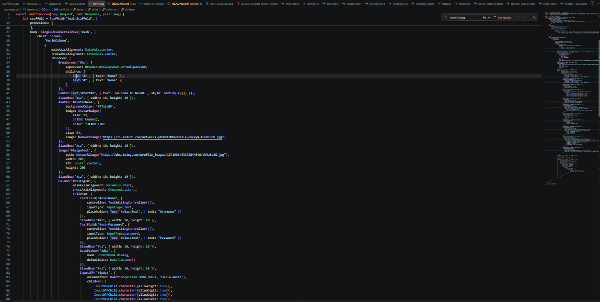
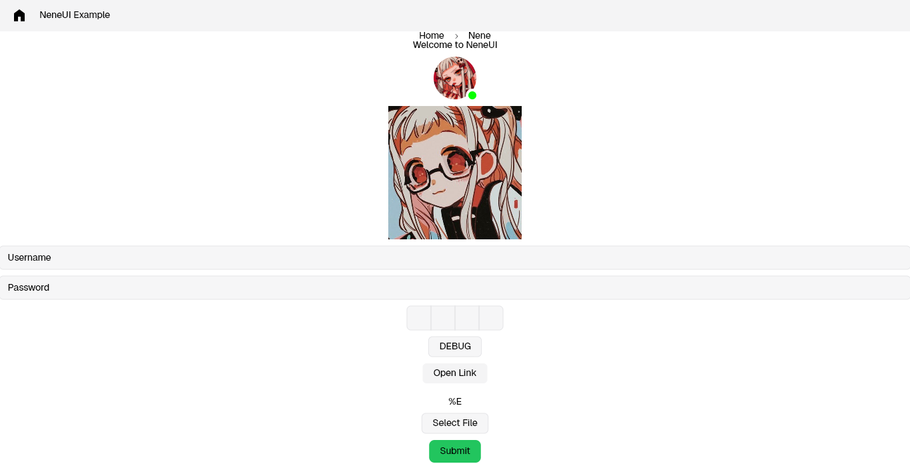

<p align="center">
  
</p>

# Nene UI Runtime

Build Flutter interfaces dynamically from a JavaScript server.

# Docs
Don't know what to do Or how to use NeneUI? Access the Documentation of NeneUI Below!

<a href="https://kwe26.github.io/neneui/">
  
</a>

# Video Demo

[Watch the Video on YouTube](https://www.youtube.com/watch?v=ts1DRFQp28c)

## Features

- Server-driven UI
- JavaScript backend
- Flutter rendering
- Dynamic widgets

| Server-Side Code | Rendered UI |
|:---:|:---:|
|  |  |
| *Server-Side Code* | *Rendered UI* |

## Getting Started

# Requirements
- Flutter SDK (3.38.6 or above)
- Bun.sh 1.3.x
- JavaScript & Dart Knowledge obv

### Psst!
*In case you don't have Flutter SDK Installed or don't wannta compile things, you can try out the modications you made in example_ui in NeneUI Testing Kit*

<a href="https://github.com/kwe26/neneui/releases/">
  
</a>

[NeneUI Testing Kit (In Case You cannot find!)](https://github.com/kwe26/neneui/releases/tag/nene-tester-1.0.1)


## Getting Started With an Sample

Clone the Sample Repo
```bash
git clone https://github.com/kwe26/neneui-sample.git sample
```

### Install The Packages For Bun and Flutter

```bash
cd sample && bun install
```

### Compile the Flutter App Linking to NeneUI 

```bash
cd flutter_app && flutter pub get
```

### Run the Server
```bash
bun run index.ts
```

### Run The Flutter App
> The Backend must be running at localhost:3500 or you can change it too.
> Recommended Platforms: Windows, Linux, Android only! (Not tested with Web, macOS, iOS)
```bash
flutter run
```

### Tweaking
`sample/example_ui/home.ts`
*You can modify the UI and Add More Widgets and test the Library*

# Test Library

```bash
cd ./flutter_render/example && flutter run -d
```

# FAQ
<a href="https://kwe26.github.io/neneui/">
  
</a>

**1. Linux Build won't compile and error out**
> It is caused due to the quickjs_engine missing a critical header for Linux The fix is below
```bash
find "$HOME/.pub-cache" -name "quickjs_engine_plugin.h" -exec sed -i \
            's/#include <flutter_linux\/flutter_linux.h>/#include <flutter_linux\/flutter_linux.h>\n\n#ifndef FLUTTER_PLUGIN_EXPORT\n#ifdef FLUTTER_PLUGIN_IMPL\n#define FLUTTER_PLUGIN_EXPORT __attribute__((visibility("default")))\n#else\n#define FLUTTER_PLUGIN_EXPORT\n#endif\n#endif/' {} +
```

**2. I Cannot Insepect Element in Web version of NeneUI**
> As of now, NeneUI uses Flutter to render in Web as well, So not only you can not do Inspect Element but some SEO features will be missing too

**3. I added a Widget in my Code, But it won't show up even if i have restarted?**
> You must check whether your `neneui_render` Package is up-to-date with `@neneys/ui`. If you are trying on NeneUI Testing Kit, Make sure it's up-to-date as well. 

# Links & Credits
- [Documented Widgets](https://kwe26.github.io/neneui/)
- [Sample App](https://github.com/kwe26/neneui-sample)
- [shadcn_ui Flutter used for UI Components](https://github.com/sunarya-thito/shadcn_flutter)